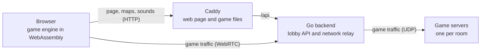

# CS Duds

Counter-Strike 1.6 that you play in a browser tab. You host it yourself. Players need no install and no Steam account.

## How it works

1. The browser loads the page and the game files from Caddy, and keeps them cached.
2. The lobby lists the rooms. Creating a room starts a new game server on the machine.
3. When you join, the browser opens a WebRTC connection to the Go backend. The backend
   passes every game packet to that room's server and back.

## Run it

You need Linux, Docker with Compose, about 10 GB of disk and Chrome or Firefox.

    git clone --recursive https://github.com/dudustri/cs-duds-manager
    cd cs-duds-manager
    docker compose up --build
    xdg-open http://localhost

Already cloned without `--recursive`? Run `git submodule update --init --recursive` first.

The first build downloads the game server files and the community maps, and compiles the browser
engine. It takes a while. Later builds use the cache. To change a setting, copy `.env.example` to
`.env` and edit it.

## The browser engine

The game in the browser is Xash3D FWGS with the CS 1.6 client, compiled to WebAssembly from their
official source. We never use prebuilt engine files.

- `third_party/xash3d-fwgs` and `third_party/cs16-client` are git submodules, each pinned to one commit.
- `engine/patches/` holds our small fixes for the browser build, one short patch per fix.
- `engine/net.js` sends the engine's network traffic through our WebRTC connection.
- The `engine` stage in the `Dockerfile` builds it all with the official Emscripten image.

Dependabot proposes submodule updates once a week. Read the upstream changes, check that the patches
still apply and the tests pass, then merge.

## What you get

- 10 modes: classic, deathmatch, free for all, GunGame, zombie, aim, AWP, knife, surf and climb.
- About 245 maps: the stock maps plus community maps. Special maps only show up in their own mode.
- A lobby with quick play, a server list, a players page and a page to create a server.
- Host controls in the game overlay: kick, bots and map votes. Chat votes with `rtv` and `/votekick`.

## Admin

    printf '%s' 'my-password' | docker compose run --rm -T backend hash-password >> .env
    docker compose up -d

Then open http://localhost/admin to stop rooms and use host controls in any room.

## Tests

    scripts/test          # quick tests, no Docker
    scripts/test stack    # starts the real stack and plays it in a headless browser

## More

- `docs/PLAN.md`: what the project is, the choices made and what comes next.
- `docs/ARCHITECTURE.md`: diagrams of every part.
