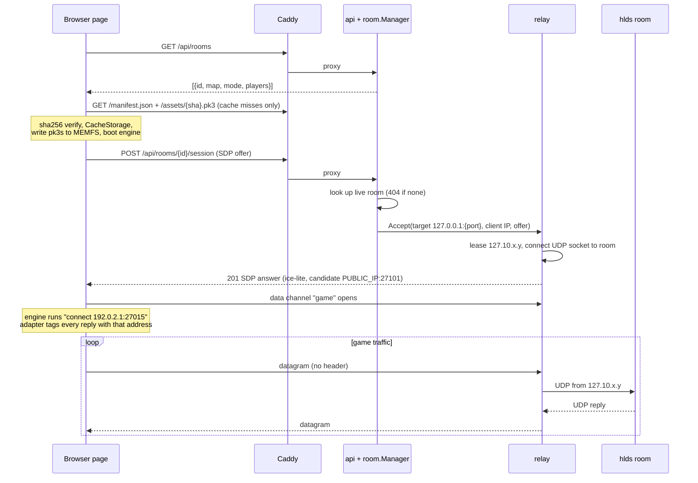
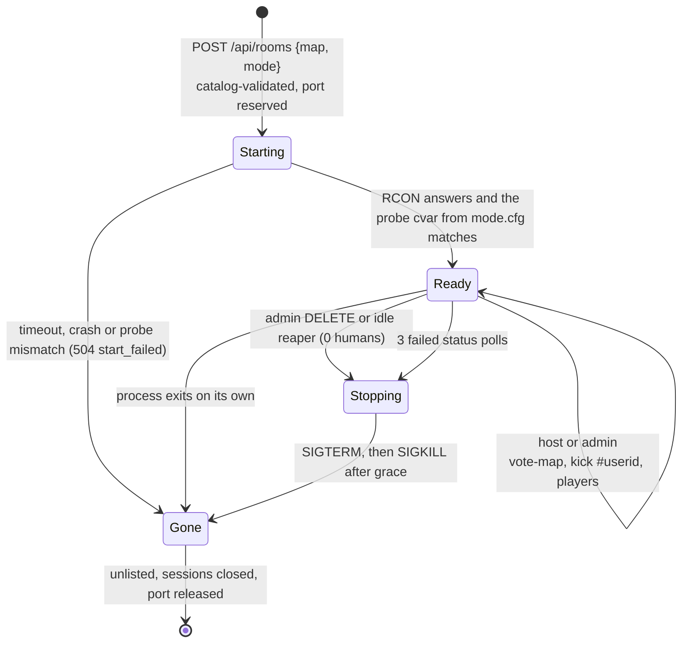
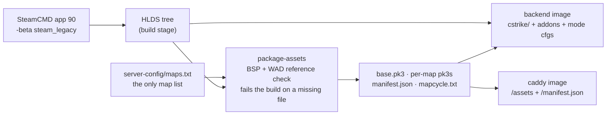

# Architecture

How the parts fit together. `PLAN.md` explains the choices behind them.

## Components

```mermaid
flowchart LR
    subgraph Browser["Browser tab"]
        UI["Page UI<br/>room list · create room · host panel"]
        Assets["assets.ts<br/>manifest + CacheStorage<br/>sha256-verified pk3s"]
        Engine["Xash3D-FWGS WASM<br/>+ cs16-client (vendored 1.2.2)<br/>pk3s mounted in MEMFS"]
        Transport["transport.ts<br/>RTCPeerConnection + Net adapter<br/>engine sees 192.0.2.1:27015"]
        UI --> Assets --> Engine
        Engine <--> Transport
    end

    subgraph Host["host network (docker compose, network_mode: host)"]
        subgraph CaddyC["caddy container"]
            Caddy["Caddy :80<br/>static page + /assets (immutable)<br/>proxy /api/* to 127.0.0.1:18468"]
        end

        subgraph Backend["backend container: one Go binary cs-backend"]
            API["api<br/>REST /api/*<br/>host token · admin cookie · rate limits"]
            Relay["relay<br/>ICE-lite pion on UDP 27101<br/>one unreliable 'game' channel"]
            Rooms["room.Manager<br/>single owner of rooms + ports<br/>supervisor goroutine per room"]
            subgraph HLDS["hlds_linux children on 127.0.0.1:27015-27020"]
                R1["room A<br/>classic · de_dust2"]
                R2["room B<br/>deathmatch"]
                R3["room C<br/>gungame"]
            end
            API --> Rooms
            API -- "POST /session to Accept(Target)" --> Relay
            Rooms -- "spawn · RCON status/kick/votemap · stop" --> HLDS
        end
    end

    UI -- "/api" --> Caddy
    Assets -- "/assets/sha256.pk3" --> Caddy
    Transport -- "POST /api/rooms/{id}/session<br/>SDP offer to answer" --> Caddy
    Caddy --> API
    Transport <-- "WebRTC data channel<br/>UDP 27101 (PUBLIC_IP = LAN IP)" --> Relay
    Relay <-- "connected UDP socket<br/>from 127.10.x.y per player" --> HLDS
```

Each room runs ReHLDS + ReGameDLL_CS + Metamod-R + ReUnion + AMX Mod X, plus GunGame
compiled from source. Every one of them is pinned by version and sha256 in
`backend/docker/pins.txt`.

## Joining a room

There is no destination address on the wire. The room id in the session URL is the only
thing a client chooses, and only live rooms resolve, so the relay can't be used as an open
proxy.

## Room lifecycle and host controls

## Content pipeline (inside `docker build`)

